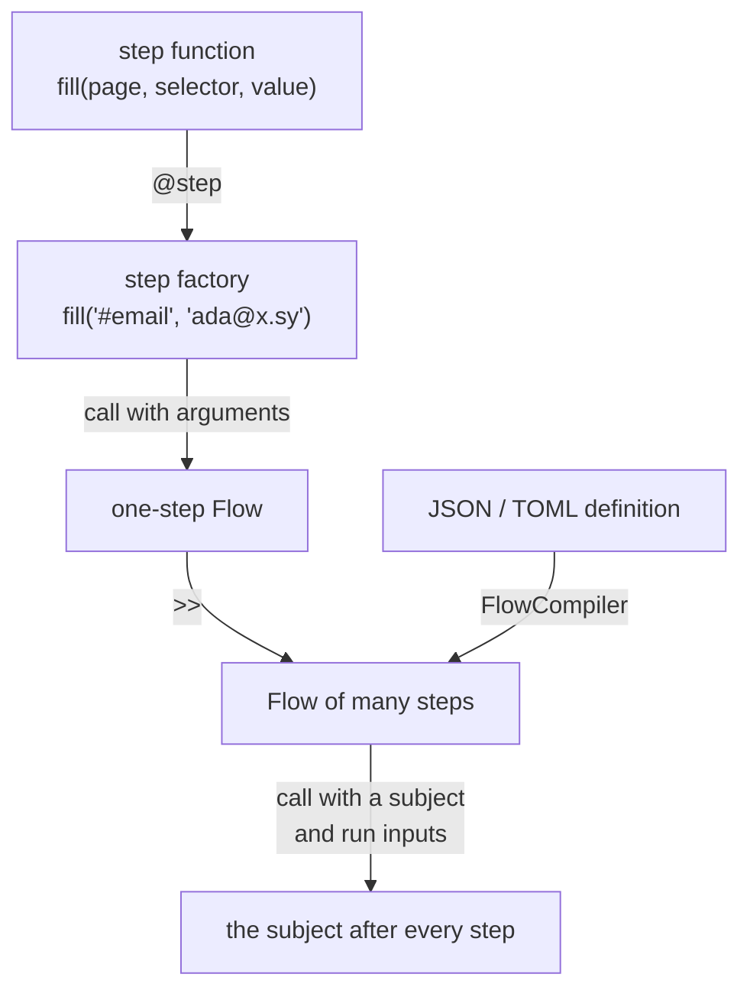

# User guide

pyflowstep has a handful of pieces. Each page covers one of them with examples you can
paste and run (every `python` block in these docs is executed by the test suite).

| Piece | What it is | Page |
| --- | --- | --- |
| `step`, `tap`, `Flow`, `compose` | step factories and the flows they compose into | [Steps and flows](steps.md) |
| `StepsRegistry` | the named vocabulary of a flow language | [Registries](registries.md) |
| `Process`, argument errors | converting raw JSON values, failing early | [Arguments and processing](arguments.md) |
| `Depends`, `override_dependencies` | injecting sessions, clients, settings | [Dependencies](dependencies.md) |
| `Input`, `output`, `Flow.signature` | per-run values and values passed between steps | [Run inputs and outputs](inputs.md) |
| `override`, `chain` | step variants and named groups of steps | [Variants and chains](variants-and-chains.md) |
| `FlowCompiler`, `register_flow_format` | flows from JSON, TOML and other files | [Compiling flows](compiling.md) |
| `get_*_json_schema` | JSON Schema of your flow language | [JSON Schema](json-schema.md) |
| pyspecification, pyformula | rules and formulas as step arguments | [With pyspecification and pyformula](family.md) |

## The mental model

1. You write a **step function**: its first parameter is the **subject** the flow works
   on (a page, an order, a record); the others are the step's arguments.
2. A decorator turns it into a **step factory**. Calling the factory checks and processes
   the arguments right away and returns a one-step **flow**.
3. Flows **compose** with `>>` into longer flows. A flow is immutable: `>>` returns a new
   one.
4. Calling a flow with a subject **runs** every step in order, each one receiving what
   the previous one returned.

Everything that can be checked is checked in step 2 (or when a [JSON flow is
compiled](compiling.md)), so a typo fails before the first step touches your data.

## Where values come from

A step parameter gets its value in one of four ways:

| The value is... | Write | Given | Page |
| --- | --- | --- | --- |
| part of the flow definition | `selector: str` | when the flow is built: `click("#go")` | [Steps](steps.md) |
| an object a provider builds | `db: Session = Depends(get_session)` | by the provider, once per run | [Dependencies](dependencies.md) |
| only known by the caller of the flow | `user: User = Input()` | when the flow runs: `flow(page, user=ada)` | [Run inputs](inputs.md) |
| produced by an earlier step | `number: str = Input()` + `@output("number")` | by the earlier step, during the run | [Outputs](inputs.md#outputs) |
